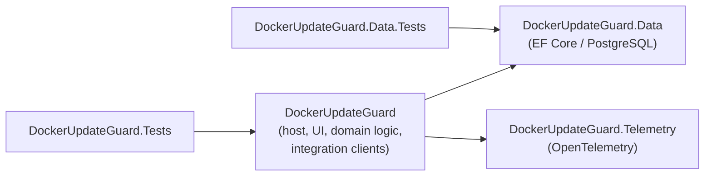
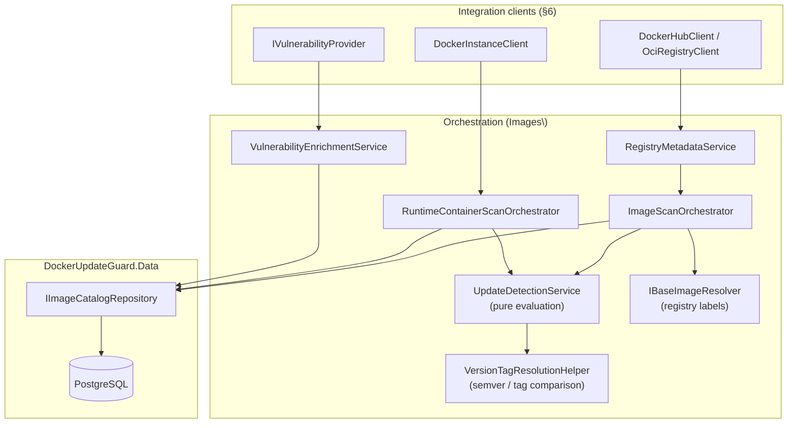

# Architecture

<!-- project:begin architecture -->
This document describes the architecture of DockerUpdateGuard as currently
implemented: how the parts fit together and why. It is a technical reference
for contributors and AI coding agents working in this repository. What each
part guarantees — formats, defaults, limits, error behavior — is written once
in the [area documents](areas/README.md) and linked from here instead of
repeated. It also complements [README.md](../README.md) (product scope,
configuration reference), the [docs/](.) folder (contribution, testing,
deployment tiers), and [AGENTS.md](../AGENTS.md) /
[.github/copilot-instructions.md](../.github/copilot-instructions.md) and
[.github/instructions/csharp.instructions.md](../.github/instructions/csharp.instructions.md)
(coding conventions).

## 1. Purpose and shape of the system

DockerUpdateGuard is a single-process ASP.NET Core web application that:

1. discovers Docker Engine instances and the containers running on them
   ([Docker instances](areas/docker-instances.md)),
2. correlates what is running with registry tag/digest data to detect
   available or needed updates ([Registries](areas/registries.md),
   [Image catalog](areas/image-catalog.md),
   [Update detection](areas/update-detection.md)),
3. resolves base-image relationships and reuse across observed images
   ([Base images](areas/base-images.md)),
4. enriches images with vulnerability data from Trivy or Docker Scout
   ([Vulnerabilities](areas/vulnerabilities.md)),
5. records the results of all of the above as history in PostgreSQL
   ([Scan engine](areas/scan-engine.md)), and
6. serves a Blazor Server UI over that data ([Web UI](areas/web-ui.md)).

There is no separate API tier, message queue, or worker process — scanning,
persistence, and UI all run inside one ASP.NET Core host, coordinated
in-process via `IHostedService` background jobs and a shared PostgreSQL
database. This keeps deployment to a single container plus PostgreSQL (see
§13), at the cost of the background scan engine and the UI sharing the same
process and connection pool.

## 2. Solution layout

```
DockerUpdateGuard.slnx
├── src\DockerUpdateGuard              # ASP.NET Core host (Microsoft.NET.Sdk.Web) — composition root
├── src\DockerUpdateGuard.Data         # EF Core / PostgreSQL persistence layer
├── src\DockerUpdateGuard.Telemetry    # OpenTelemetry hosting/export layer
└── src\Tests
    ├── DockerUpdateGuard.Tests        # Host/UI/domain tests (MSTest, NSubstitute, bUnit, EF InMemory)
    └── DockerUpdateGuard.Data.Tests   # Data-layer tests (MSTest, EF Core against real SQLite)
```



`DockerUpdateGuard.Data` and `DockerUpdateGuard.Telemetry` do not reference
the host project or each other. Web startup, DI wiring, background jobs,
integration clients, domain/scan logic, and the Blazor UI all live in the
host project — there is intentionally no separate "Application"/"Domain"
assembly; the boundary that matters in this codebase is persistence vs.
observability vs. everything else. Persistence stays in `.Data`;
observability stays in `.Telemetry`; the host project owns composition.

Solution-wide conventions (`.slnx` format, `net10.0`, nullable/implicit
usings, `SharedAssemblyInfo.cs`, per-configuration rulesets, centralized
`GlobalSuppressions.cs`, `Reihitsu.Analyzer` + `SonarAnalyzer.CSharp`) are
documented in [AGENTS.md](../AGENTS.md) and not repeated here.

## 3. Host composition and startup sequence

`src\DockerUpdateGuard\Program.cs` is intentionally thin. It delegates DI
registration to `ServiceCollectionExtensions.AddDockerUpdateGuardHost`, the
composition root, which in order:

1. Binds and validates `DockerUpdateGuardOptions` (`.ValidateOnStart()`).
2. Resolves the PostgreSQL connection string
   (`DockerUpdateGuardConnectionStringResolver`) and registers the EF Core
   context via `DockerUpdateGuard.Data`'s `AddDockerUpdateGuardData`.
3. Registers OpenTelemetry via `DockerUpdateGuard.Telemetry`'s
   `AddDockerUpdateGuardTelemetry`.
4. Registers the typed/named `HttpClient`s (Docker Hub, generic OCI
   registry, .NET/nginx release metadata, Portainer) with
   `TransientHttpRetryHandler` as their outbound message handler.
5. Registers the integration clients, domain/orchestration services, the
   UI facade (`IApplicationViewService`), and all 7 background jobs
   (`AddHostedService<T>()`) — see §6 to §8.

`Program.cs` then adds MudBlazor (`AddMudServices()`) and Razor Components
with **Interactive Server** rendering — Blazor Server only, no WebAssembly or
Auto render mode anywhere in the app.

After `WebApplication.Build()` and before `RunAsync()`, the host calls
`ApplicationInitializationExtensions.InitializeDockerUpdateGuardAsync`,
which blocks startup on three steps:

1. `DatabaseMigrator.MigrateAsync` — waits for the database, then applies
   EF Core migrations under a PostgreSQL session-scoped advisory lock, so
   concurrently starting instances never migrate at the same time.
2. `IInstanceDiscoveryService.SynchronizeConfiguredInstancesAsync` —
   reconciles the configured Docker instances against the database
   (local, DB-only work).
3. `ApplicationTelemetry.RefreshInventoryMetricsAsync` — seeds the
   inventory gauges (§10).

Network-bound work (Docker Hub account discovery, scans) is deliberately
not part of this blocking sequence: it runs as the first iteration of the
background jobs once the host accepts traffic (§8), so a slow or
unreachable remote system does not delay startup.

The exact startup order, retry and timeout values, the middleware pipeline
and error pages, and how configuration reload behaves are specified in
[Hosting and configuration](areas/hosting.md). There is no authentication,
authorization, health-check, or rate-limiting middleware (§11).

## 4. Configuration model

Configuration is bound from the `DockerUpdateGuard` and `Telemetry` sections
via standard ASP.NET Core configuration (files, environment variables,
command line). The key-by-key reference lives in
[README.md](../README.md#configuration-reference); which keys are validated,
which apply on reload and which need a restart is specified in
[Hosting and configuration](areas/hosting.md), and the meaning of each
feature's keys in that feature's area.

Architecturally relevant points:

- One `IValidateOptions<T>` validator covers the whole `DockerUpdateGuard`
  section and one the `Telemetry` section, both wired with
  `.ValidateOnStart()`, so misconfiguration is a startup failure, not a
  runtime surprise.
- The `DockerUpdateGuard` validator also loads each configured client
  certificate of an enabled Docker instance through `ClientCertificateLoader`,
  the same loader `DockerInstanceClient` uses, so a certificate accepted at
  startup is loaded by the same rules at runtime; it is the validator's only
  file read
  ([record 0007](decisions/0007-client-certificates-are-validated-as-pkcs12-at-startup.md)).
- The background jobs and `TransientHttpRetryHandler` read
  `IOptionsMonitor<DockerUpdateGuardOptions>` on every use, so schedule and
  retry settings follow a configuration reload. Settings consumed while the
  container is composed (`HttpClient` base addresses and timeouts, the
  database, telemetry) are fixed until restart.
- `DockerUpdateGuardConnectionStringResolver` is used identically by the DI
  registration and the validator, so the two can never disagree about which
  connection string is active.

## 5. Data layer (`DockerUpdateGuard.Data`)

EF Core over PostgreSQL (`Npgsql.EntityFrameworkCore.PostgreSQL`).
`DockerUpdateGuardDbContext` exposes 15 `DbSet<T>`; entity configuration
uses one `IEntityTypeConfiguration<T>` per entity under `Configurations\`,
auto-discovered via `ApplyConfigurationsFromAssembly`.

### 5.1 Entity model

| Entity | Role | Area |
| --- | --- | --- |
| `RegistryRepository` | `(Registry, Repository)` pair; parent of all `ImageVersion` rows for that repository. | [Image catalog](areas/image-catalog.md) |
| `ImageVersion` | Deduplicated `(repository, tag, digest)` node — the central catalog entity; carries a vulnerability-assessment rollup. | [Image catalog](areas/image-catalog.md) |
| `ImageRelationship` | Edge from a child `ImageVersion` to its base `ImageVersion`, with type and `Depth` — the base-image dependency graph. | [Base images](areas/base-images.md) |
| `ObservedImage` | A manually or discovery-registered "track this image" target; points at a `CurrentImageVersion`. | [Image catalog](areas/image-catalog.md) |
| `DockerInstance` | A configured Docker Engine endpoint; optionally has one `PortainerEndpoint`. | [Docker instances](areas/docker-instances.md) |
| `PortainerEndpoint` | Portainer connection details for a `DockerInstance`. | [Container actions](areas/container-actions.md) |
| `ContainerSnapshot` | A discovered container at a point in time, with its `UpdateAssessmentStatus`. | [Docker instances](areas/docker-instances.md) |
| `ScanRun` | A persisted scan execution (type/status/trigger), optionally scoped to an `ObservedImage` or `DockerInstance`. | [Scan engine](areas/scan-engine.md) |
| `UpdateFinding` | A detected update (subject `ImageVersion` → optional recommended `ImageVersion`), linked to an `ObservedImage` and/or `ContainerSnapshot`. | [Update detection](areas/update-detection.md) |
| `TagCandidate` | One ranked candidate tag belonging to an `UpdateFinding`. | [Update detection](areas/update-detection.md) |
| `VulnerabilityFinding` | A CVE/advisory against an `ImageVersion` (severity, fix status, CVSS). | [Vulnerabilities](areas/vulnerabilities.md) |
| `ContainerActionRun` | A record of a Portainer action against a container, service, or stack. | [Container actions](areas/container-actions.md) |
| `RuntimeContainerTagSelection` | A user's tag/digest selection for a specific runtime container. | [Update detection](areas/update-detection.md) |
| `DockerInstanceResourceSample` / `RuntimeContainerResourceSample` | Instance-level and per-container CPU/memory/network time series. | [Docker instances](areas/docker-instances.md) |

Every enum used by these entities lives alongside them in the `Entities`
namespace.

### 5.2 Repositories vs. Queries

The `Repositories\` and `Queries\` folders are deliberately split by
read/write intent, not by entity:

- **`Repositories\` — `IImageCatalogRepository`.** The single write-side
  entry point for the `RegistryRepository`/`ImageVersion` catalog. Its
  get-or-create methods enforce catalog uniqueness, including a race-retry
  path for concurrent get-or-create calls, so scanners never create
  duplicate catalog rows ([Image catalog](areas/image-catalog.md)). This is
  the only repository in the project — no entity outside the catalog
  needed one.
- **`Queries\` — `ILiveImageInventoryQueryService`,
  `ISharedBaseImageQueryService`.** Read-only, multi-entity, page-shaped
  projections that return plain DTOs instead of tracked entities and don't
  naturally belong to any single entity's repository.
  `ILiveImageInventoryQueryService` is the shared definition of "still
  relevant" that cleanup uses to decide what history to keep
  ([Scan engine](areas/scan-engine.md)).

### 5.3 Migrations

Current migrations, in order: `InitialCreate` → `Update1` → … → `Update7`
(latest). New migrations follow the `Update{N}` naming convention described
in [AGENTS.md](../AGENTS.md#project-configuration); `Design\
DockerUpdateGuardDbContextFactory` provides the design-time `DbContext` for
`dotnet ef` tooling.

## 6. Integration clients

Each external system has one hand-written client behind a narrow interface
— there is no dependency on `Docker.DotNet`, a Portainer SDK, or a Trivy
client library. Clients return plain DTOs wrapped in
`ExternalOperationResult<T>` (`Infrastructure\ExternalOperationResult{T}.cs`)
for expected failure modes, and orchestrators branch on that status instead
of on exceptions. The outcomes and where errors still escape are specified
in [Registries](areas/registries.md#failure-model-of-integrations).

| Client | Talks to | Area |
| --- | --- | --- |
| `DockerInstanceClient` (`Docker\`) | Docker Engine HTTP API over `http(s)://`, `tcp://`, `unix://` and `npipe://`, one hand-built `HttpClient` pooled per connection config. | [Docker instances](areas/docker-instances.md) |
| `DockerHubClient` (`DockerHub\`) | Docker Hub REST API **and** the OCI Distribution v2 API (`registry-1.docker.io`); implements both `IDockerHubClient` and the generic `IRegistryMetadataClient`, because Docker Hub is both a metadata API and an OCI registry. | [Registries](areas/registries.md) |
| `OciRegistryClient` (`Images\`) | Any other OCI Distribution v2 registry. | [Registries](areas/registries.md) |
| `PortainerClient` (`Portainer\`) | Portainer REST API (API key or JWT login), endpoint and container listing, container actions. | [Container actions](areas/container-actions.md) |
| `TrivyVulnerabilityProvider` (`Vulnerabilities\`) | Trivy CLI (external process via `IProcessRunner`), client mode against a Trivy server. | [Vulnerabilities](areas/vulnerabilities.md) |
| `DockerScoutVulnerabilityProvider` (`Vulnerabilities\`) | Docker Scout / Docker Hub HTTP API. | [Vulnerabilities](areas/vulnerabilities.md) |
| `DefaultVulnerabilityProvider` (`Vulnerabilities\`) | — (no-op fallback selected by `IVulnerabilityProviderResolver` when scanning is disabled). | [Vulnerabilities](areas/vulnerabilities.md) |

`RegistryMetadataService` is the dispatcher in front of
`IRegistryMetadataClient`: it holds every registered client and picks the
first whose `CanHandle(registry)` matches, falling back to
`NullRegistryMetadataClient` (an `Unsupported` sentinel) — adding a new
registry type means adding one more `IRegistryMetadataClient`
implementation, not touching the dispatcher.

`TransientHttpRetryHandler` (`Infrastructure\`) is attached to the
typed/named `HttpClient`s registered in the composition root (§3). The
Docker Engine client and Docker Scout create their `HttpClient`s without
it. The retry policy is specified in
[Registries](areas/registries.md#retry-of-transient-http-failures).

## 7. Domain / orchestration layer and the scan engine

`src\DockerUpdateGuard\Images` is the largest folder in the project and is
where integration-client DTOs turn into persisted findings. Clients never
touch `DockerUpdateGuardDbContext` directly; orchestrators do:



- **`IUpdateDetectionService` (`UpdateDetectionService`)** is a pure
  evaluator (no network or database I/O) over an image reference and its
  tags, and **`VersionTagResolutionHelper`** is the tag-comparison engine
  behind it, so update logic — including the deliberately conservative
  major-upgrade gating — can be unit-tested without mocking HTTP or the
  database. The rules themselves are in
  [Update detection](areas/update-detection.md).
- **`IBaseImageResolver`** (registered as `RegistryBaseImageResolver`)
  resolves base images from registry image labels; **`IDerivedBaseRuntimeDetector`**
  infers a .NET/nginx runtime from environment variables (and, for runtime
  containers, image history), which `IDotNetReleaseMetadataService`/
  `INginxReleaseMetadataService` compare against upstream release feeds.
  This covers images without a useful base-image label, at the cost of only
  recognizing the two runtimes it has explicit rules for
  ([Base images](areas/base-images.md)).
- **`ImageScanOrchestrator`** guards against overlapping scans of the same
  observed image with a static per-image `SemaphoreSlim` registry, not a
  database lock — a same-process concurrency guard, not a multi-instance
  one (§11, [Scan engine](areas/scan-engine.md)).
- Orchestrators write directly to `DbContext` sets (`UpdateFindings`,
  `ImageRelationships`, `ScanRuns`) for their own aggregates, and go
  through `IImageCatalogRepository` only for the shared, dedup-sensitive
  `RegistryRepository`/`ImageVersion` catalog.

## 8. Background job engine

All seven scheduled jobs derive from `ScheduledBackgroundService`
(`Images\ScheduledBackgroundService.cs`), a template-method
`BackgroundService`: subclasses supply `GetInterval()` and
`ExecuteCoreAsync`, optionally `ExecuteStartupAsync` (runs once before the
loop) and override `ShouldExecuteImmediately()` (default `true`). The base
class re-evaluates `GetInterval()` every iteration (so config-reload
changes apply live), creates a DI scope per run, and catches and logs
exceptions from `ExecuteCoreAsync`, so a failing run does not end the job.

| Job | Does |
| --- | --- |
| `DockerInstanceDiscoveryBackgroundService` | Reconciles configured Docker instances against the DB. |
| `DockerHubAccountImageDiscoveryBackgroundService` | Discovers repositories/images under the configured Docker Hub account. |
| `OwnImageBaseRefreshBackgroundService` | Scans all enabled observed images (`ImageScanOrchestrator.ScanAllAsync`) on a dynamic interval. |
| `RuntimeContainerRefreshBackgroundService` | Scans running containers (`RuntimeContainerScanOrchestrator.ScanAllAsync`). |
| `ResourceStatisticsRefreshBackgroundService` | Samples Docker instance/container CPU/memory/network usage. |
| `VulnerabilityRefreshBackgroundService` | Refreshes CVE findings via the resolved `IVulnerabilityProvider`. |
| `ScanCleanupBackgroundService` | Repairs stale `Running` scan rows on startup, then purges history past retention. |

Intervals and their configuration keys, the dynamic own-image interval that
stretches with the number of observed images to stay within the Docker Hub
request budget, overlap rules, scan-run statuses, crash recovery and
retention are specified in [Scan engine](areas/scan-engine.md). Docker Hub
traffic is shaped by that schedule, by a per-client concurrency limit and
by the transport retry (§6); none of them counts requests. Their exact
behavior is in [Registries](areas/registries.md).

## 9. UI layer

Blazor Server (**Interactive Server** render mode, applied at the `App`
root — no WebAssembly, no Auto mode) with **MudBlazor** as the component
library, plus a hand-rolled CSS design-system layer
(`wwwroot\app.css`, light/dark via a `.dug-dark` class) on top of it.
Pages, routes and what each page shows or triggers are specified in
[Web UI](areas/web-ui.md).

- **Pages** (`Components\Pages`) have one `@page` route each.
- **`IApplicationViewService` (`UI\ApplicationViewService`)** is the single
  facade every page depends on. It maps `DockerUpdateGuard.Data` entities
  into `*ViewData` DTOs (`UI\`) — pages never query
  `DockerUpdateGuardDbContext` or the repositories/query services
  directly. This keeps EF Core change-tracking and entity shapes out of
  the component tree, at the cost of `ApplicationViewService` being a
  fairly wide surface (one method per page/section).
- **`Components\Shared`** holds cross-page building blocks: loading
  skeletons and the vulnerability widgets shared between the
  Vulnerabilities page and image/container detail pages.
- **`DashboardRefreshState`** is a small singleton pub/sub class that
  manual-scan actions in the UI use to signal open Dashboards to refresh
  without a full page reload.

## 10. Telemetry

`DockerUpdateGuard.Telemetry.AddDockerUpdateGuardTelemetry` wires
OpenTelemetry logging, tracing, and metrics, exported over a single OTLP
exporter. A custom `ActivitySource` and `Meter` live in the telemetry
project (`DockerUpdateGuardTelemetry`, `TelemetryActivityNames`);
`ApplicationTelemetry` in the host project owns the application-specific
instruments. Logging is structured, via `ILogger<T>` and source-generated
`[LoggerMessage]` partial classes — every integration client and
background job has a matching `*Logging.cs` partial class rather than
ad-hoc `_logger.LogInformation(...)` calls. Switches, export conditions,
the emitted span and instrument names, and when the inventory gauges
refresh are specified in [Telemetry](areas/telemetry.md).

## 11. Security posture and operating assumptions

These are observed characteristics of the current implementation; the
details are in [Hosting and configuration](areas/hosting.md) and the areas
it links:

- **No authentication or authorization layer.** The application is meant
  to be deployed behind network-level access control (private network,
  VPN, or a reverse proxy that terminates auth) — a deployment
  responsibility, not something the app enforces. See
  [SECURITY.md](../SECURITY.md) for the vulnerability-reporting process.
- **No health-check or rate-limiting endpoints** are registered.
- **Single-instance assumption for the scan engine.** The advisory lock
  (§3) serializes *migrations* across concurrently starting instances, but
  the background jobs and `ImageScanOrchestrator`'s in-memory scan lock
  (§7) are not distributed — running more than one instance against the
  same database duplicates scan work rather than coordinating it; catalog
  writes stay correct via `IImageCatalogRepository`'s race-retry.
- **Container runs as a non-root user** (UID 64000, GID 0) so a
  group-owned, root:root Docker socket bind-mount stays readable without
  running the process as root; see
  [src/DockerUpdateGuard/Dockerfile](../src/DockerUpdateGuard/Dockerfile).
  Mounting the host's Docker socket is nonetheless root-equivalent on the
  host and inherent to the feature.
- **Secrets in configuration.** Docker Hub PAT, Portainer credentials/API
  token, and the database password are plain configuration values.
  `SkipCertificateValidation` (Docker instances) and `AllowInsecureHttp`
  (Portainer) exist for trusted/self-signed/local setups; how each is
  validated and reported is in [Docker instances](areas/docker-instances.md)
  and [Container actions](areas/container-actions.md). URLs with user info
  are logged, stored and shown with it masked as `***`, and Trivy's error output is withheld when `TrivyBaseUrl`
  contains an `@`, and the Trivy server address reaches the Trivy process in its environment (`TRIVY_SERVER`), not
  on its command line
  ([Telemetry](areas/telemetry.md), [record 0005](decisions/0005-urls-are-output-with-user-info-masked.md)).
- **Pagination stays on its origin.** `DockerHubClient`, `OciRegistryClient`
  and `DockerScoutVulnerabilityProvider` follow a next-page link only on the
  origin of the listing (`Infrastructure\PaginationLinkGuard`), so a remote
  side cannot send the Docker Hub bearer token, or any request, to another
  host; any other link ends the call *failed*. The rule is in
  [Registries](areas/registries.md#pagination-links), the reasoning in
  [0004](decisions/0004-pagination-follows-only-same-origin-links.md).

## 12. Testing architecture

Test framework, project structure, and conventions (MSTest, NSubstitute,
bUnit + MudBlazor via `BlazorTestContextFactory`, EF Core InMemory vs.
SQLite, naming, `[DataRow]`-over-branching, mandatory assertion messages)
are fully specified in [docs/UNIT_TESTS.md](UNIT_TESTS.md) and
[docs/CONTRIBUTING.md](CONTRIBUTING.md); the two test projects mirror
the two production projects that matter for this split:

- `DockerUpdateGuard.Tests` — host/UI/domain layer, EF Core **InMemory**.
- `DockerUpdateGuard.Data.Tests` — data layer, EF Core against a real
  **SQLite** database (`Data.SqliteTestDatabase`), so migrations and
  queries are exercised against a real relational provider rather than a
  test double — closer to an integration test for that layer.

## 13. Build, CI, and deployment

- **Formatting/build/test**: `reihitsu-format`, `dotnet build`, `dotnet
  test` as listed in [`.squad/stack.md`](../.squad/stack.md).
- **CI** (`.github/workflows/ci.yml`): on every push to `main` and every
  pull request — restore, format check, build, test with coverage, and
  (when `SONAR_TOKEN` is available, i.e. not on forked/Dependabot PRs)
  SonarQube Cloud analysis. `.github/workflows/codeql.yml` runs CodeQL
  separately.
- **Release** (`.github/workflows/release.yml`): triggered by pushing a
  `v*.*.*` tag — builds, tests, then builds and pushes the multi-stage
  Docker image (tagged with the version and `latest`) to Docker Hub
  (`networlddev/dockerupdateguard`) and creates a GitHub Release with
  auto-generated notes. The workflow passes the digest of
  `mcr.microsoft.com/dotnet/runtime:10.0-alpine` into the image's
  `org.opencontainers.image.base.digest` label, while the runtime stage
  builds on `mcr.microsoft.com/dotnet/aspnet:10.0-alpine`
  ([#37](https://github.com/LarsLaskowski/DockerUpdateGuard/issues/37)).
- **Container image**
  (`src/DockerUpdateGuard/Dockerfile`): multi-stage — SDK build stage,
  a `trivy` CLI stage copied in from the official Trivy image (so the
  Trivy provider works out of the box against a separately-run Trivy
  *server*), and an Alpine ASP.NET runtime stage running as the non-root
  user described in §11; see [Hosting and configuration](areas/hosting.md).
- **Deployment tiers** (`docs/docker-compose.{minimal,trivy,full}.yml`,
  walked through in [INSTALL.md](../INSTALL.md)): minimal
  (app + PostgreSQL), + Trivy server, or + a full Grafana OTel-LGTM stack
  (collector + Grafana + Loki + Tempo + Prometheus/Mimir) for the OTLP
  telemetry described in §10. All three tiers use the same published
  image; nothing about the application changes between tiers beyond
  configuration.

## 14. Key design decisions

Summarized here for quick reference; details are in the sections above.

| Decision | Rationale evidenced in the code |
| --- | --- |
| Blazor Server (Interactive Server), not WebAssembly | Keeps all data access server-side against `DockerUpdateGuardDbContext`; no separate public API surface is needed since there is no WASM client to serve one to. |
| Hand-written HTTP clients instead of `Docker.DotNet`/a Portainer SDK/a Trivy client library | Each client only needs a small slice of its target API — see §6 for what each one covers. |
| Trivy runs as an external CLI process (`IProcessRunner`), not an HTTP client to a Trivy server API | The image is scanned locally by the CLI in client mode; only the vulnerability database lookup goes to the configured Trivy server. |
| Update detection (`IUpdateDetectionService`) and tag comparison (`VersionTagResolutionHelper`) are pure, I/O-free | Lets the update-recommendation logic — including the deliberately conservative major-upgrade gating — be unit-tested exhaustively without mocking HTTP or the database. |
| One shared `IImageCatalogRepository` for the `RegistryRepository`/`ImageVersion` catalog, but no repository for any other entity | Only the catalog has a get-or-create-with-dedup concern that benefits from a single enforced entry point (§5.2); other entities are written directly by the orchestrator that owns them. |
| PostgreSQL advisory lock around migrations, but no distributed lock around scanning | Migrations are unsafe to run concurrently and are cheap to serialize once at startup; duplicate concurrent scans are wasteful but not unsafe (§11), so they were not made distributed. |
| No authentication/authorization in the app itself | The app assumes a trusted network perimeter (reverse proxy, VPN, private network) rather than implementing its own auth layer (§11). |
<!-- project:end architecture -->

## Development process

This repository is developed with Claude Code: `AGENTS.md` holds the rules every AI coding agent reads, the
skills live under `.claude/skills/` and the squad roles under `.claude/agents/`. Every pull request is reviewed
before it is opened by the read-only reviewer in `.claude/agents/squad-reviewer.md`. The squad skills
(`squad-issue`, `squad-spec`) wrap that review in a bounded pipeline described in
[`.squad/routing.md`](../.squad/routing.md): a Lead plans, picks the tier that decides how much of the pipeline
runs and owns every decision; a Devil's Advocate challenges a feature's spec and, when routing says so, the
plan; Security reviews the plan when a security area is touched; tests come first, the gates run before the
review, and every loop limit ends in a Lead decision — only one the Lead cannot make reaches the human. The stack's commands live in
[`.squad/stack.md`](../.squad/stack.md), the project's guarantees and attack surface in
[`.squad/project.md`](../.squad/project.md).

The reasoning behind individual choices is kept out of this document and recorded instead as decision
records in [`docs/decisions/`](decisions/README.md); this document describes how the system works and
links a record where a guarantee or flow is the result of one.
