# Flat UI refresh — Concept

This document describes a visual refresh of the DockerUpdateGuard web UI. It replaces the glass look of the
current interface (translucent surfaces, blur, blue gradients, large radii, a hero panel on the dashboard) with a
flat, quiet design, moves the navigation from a drawer into the top bar, and rebuilds the dashboard around the
question "what needs attention" instead of a grid of counters.

The refresh keeps the technology stack — **Blazor Server + MudBlazor** — and the responsive behavior, skeleton
loaders, persistent component state and dark mode that the [responsive redesign](../README.md) introduced. It
changes tokens, layout and a few view models; it adds no page and no action.

> The previews below are static HTML mockups (see `mockups/`) with sample data. They show the intended result at a
> viewport width of 1360 px; they are not screenshots of the running application.

## Design principles

- **Flat surfaces.** White panels on a cool grey ground, separated by hairlines. No shadows, no blur, no gradients.
- **Small radii.** 8 px for panels, 6 px for controls, 4 px for chips.
- **Color carries meaning only.** One accent color for navigation, links and primary buttons; everything else that
  is colored is a status or a severity.
- **One header per page.** A title and one sentence — no eyebrow label, no hero panel, no second description above
  the table.
- **Numbers and headlines in Space Grotesk, text in Inter.** Both fonts are self-hosted; the application loads
  nothing from a CDN.
- **Status is a dot and a word, severity is a chip.** A colored dot plus the status text for scan runs; a chip for
  update state, vulnerability status and severity.

## Design tokens

### Light theme

| Token | Value | Use |
| --- | --- | --- |
| Page ground | `#F6F7F9` | Body background |
| Surface | `#FFFFFF` | Header, panels, inputs |
| Surface subtle | `#FAFBFC` | Expanded table row |
| Border | `#E3E6EB` | Panel border, header underline, table head rule |
| Border inner | `#EEF0F3` | Row separators inside a panel |
| Border control | `#C9CED6` | Inputs, secondary buttons |
| Text | `#16191D` | Body text, headings |
| Text muted | `#5B6471` | Secondary text, column heads, labels |
| Icon | `#3D4551` | Icon buttons |
| Accent | `#2563EB` | Active navigation mark, primary button, logo |
| Link | `#1D4ED8` | Links in tables and panels |
| Attention | `#B54708` | Counts that need attention (updates, runtime warnings), `Partial` |
| Danger | `#B42318` | Vulnerability count, `Failed` and its message |
| Success | `#067647` | `Succeeded` dot, all-clear headline |

### Dark theme

| Token | Value |
| --- | --- |
| Page ground | `#0F1216` |
| Surface | `#171B21` |
| Border | `#272D36` |
| Border inner | `#20262E` |
| Text | `#E7EAEE` |
| Text muted | `#9BA5B3` |
| Accent and link | `#7AA7FF` |
| Attention | `#F2A54A` |
| Danger | `#FF8A80` |
| Success | `#5FD39A` |

The light accent `#2563EB` has too little contrast for link text on the dark surface, which is why the dark theme
uses a lighter blue.

### Chips

| Chip | Light background / text | Dark background / text |
| --- | --- | --- |
| Critical | `#7A1C12` / `#FFFFFF` | `#FF7B72` / `#1A0B0A` |
| High, warning (`Update available`) | `#FFF1E6` / `#9A3D00` | `#3A2413` / `#FFB877` |
| Medium | `#FDF3D7` / `#7A5200` | `#3A3013` / `#F0CF7A` |
| Low, neutral (`Not scanned`, `Unsupported`) | `#EEF0F3` / `#3D4551` | `#272D36` / `#C5CCD6` |
| Success (`Up to date`, `No findings`, `Recommended`) | `#E6F4EC` / `#05603A` | `#12301F` / `#7BD8A4` |
| Info (`Running`, `Manual review required`) | `#E8EFFD` / `#1D4ED8` | `#172A4D` / `#9CC0FF` |

The dark values for Medium, Low, Success and Info are not part of a mockup; they follow the pattern of the two
dark chips that are.

### Severity bar and scan strip

| Segment | Light | Dark |
| --- | --- | --- |
| Critical | `#7A1C12` | `#FF7B72` |
| High | `#D9480F` | `#E0762B` |
| Medium | `#E8A33D` | `#A67C1F` |
| Low | `#C9CED6` | `#4A5361` |
| Scan succeeded | `#9FB3C8` | `#46566B` |
| Scan partial | `#E8A33D` | `#E0A23D` |
| Scan failed | `#7A1C12` | `#FF7B72` |

In the light theme the most severe segment is the darkest, in the dark theme the lightest, so it stands out in
both. Severities differ in lightness, not only in hue.

### Charts

| Series | Line | Area fill (light) |
| --- | --- | --- |
| CPU | `#2563EB` | `#E8EFFD` |
| Memory | `#6D4AC4` | `#EFEAFA` |
| Network received | `#0F766E` | — |
| Network sent | `#B54708` | — |

### Typography and layout

- Body 14 px / 1.45 Inter; secondary text 13 px; chips 12 px semibold.
- Page title 28 px semibold Space Grotesk, letter spacing −0.02 em; dashboard headline 34 px.
- Panel title 15 px semibold Inter; figures 20–24 px semibold Space Grotesk.
- Column heads 13 px medium in the muted text color, sentence case, not uppercase.
- Content is at most 1280 px wide with 32 px side padding; the header is 60 px high; panels are 24 px apart.
- Every control is at least 44 px high.

## Previews

### Dashboard

The headline names what needs attention; three panels list the concrete items and link to the full pages. The
recent scans shrink to a strip of the last ten runs, and the inventory counters move to the bottom.

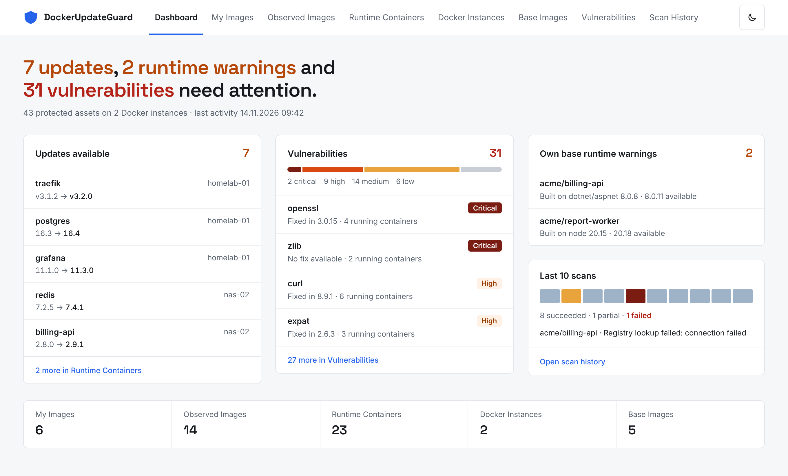

### Dashboard without findings

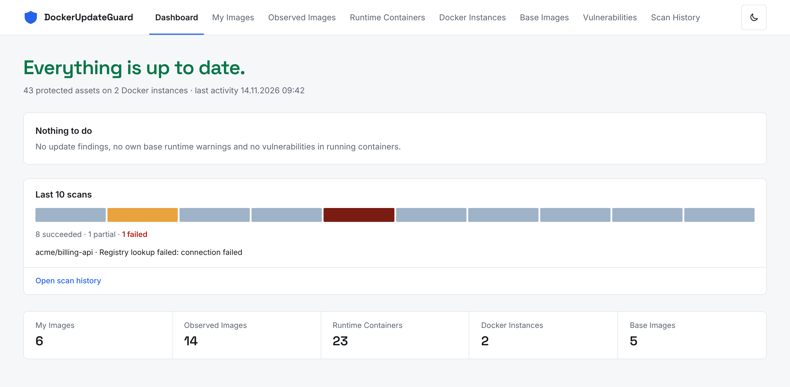

### Dashboard, dark theme

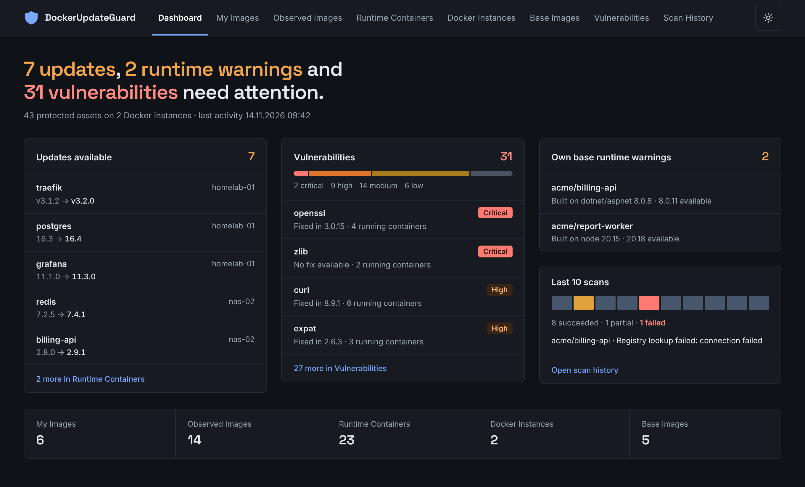

### Runtime Containers

The former *Update State* column is split into *Update* and *Vulnerabilities*; the rescan is an icon button in the
row.

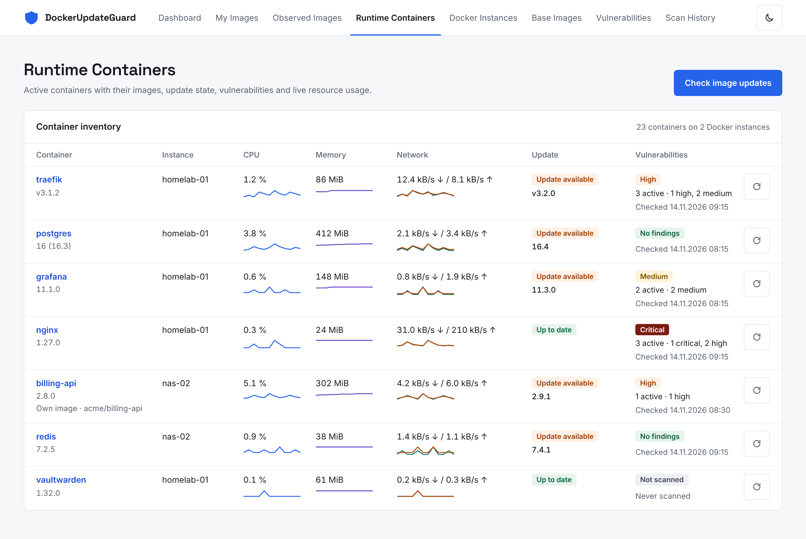

### Runtime Container detail

The summary cards become one *Details* column; status and available update sit next to the title.

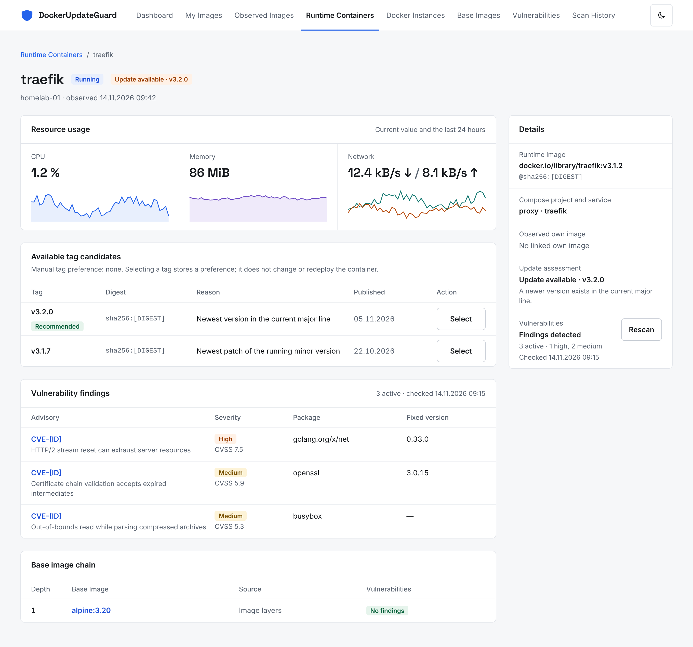

### Vulnerabilities

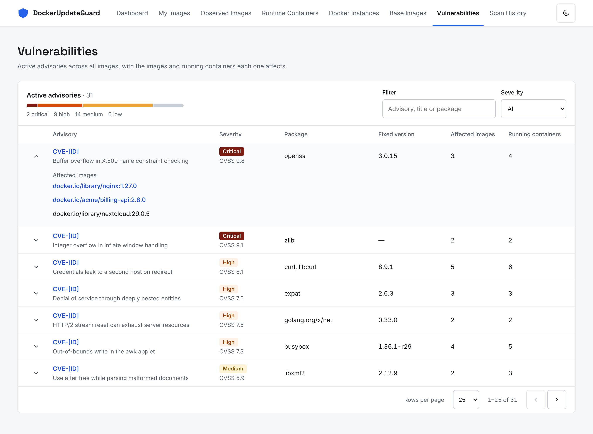

### Observed Images

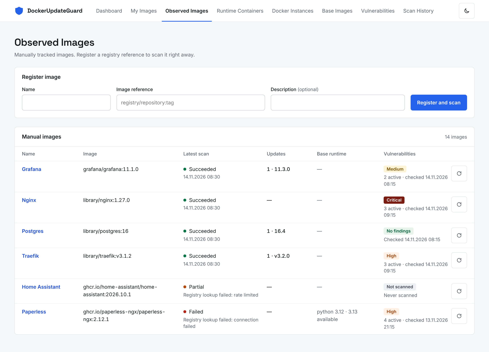

### My Images

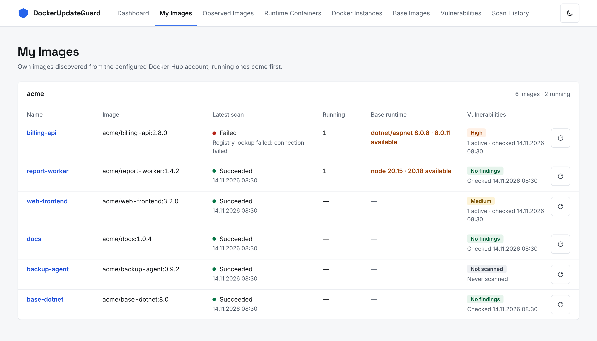

### Base Images

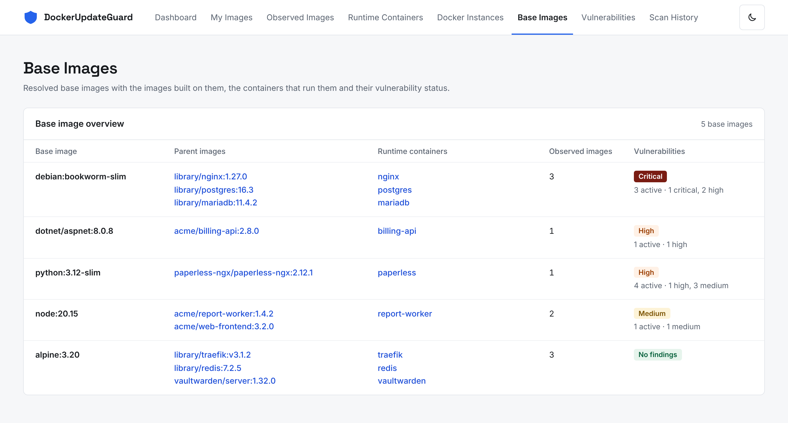

### Docker Instances

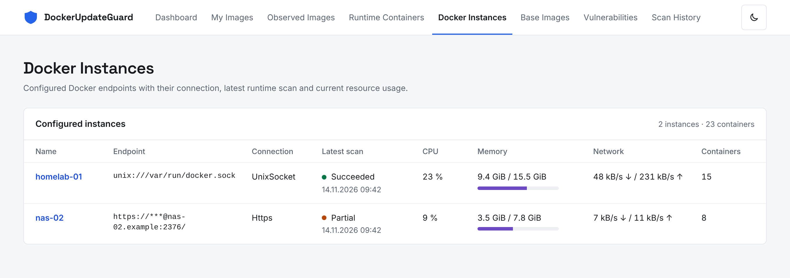

### Scan History

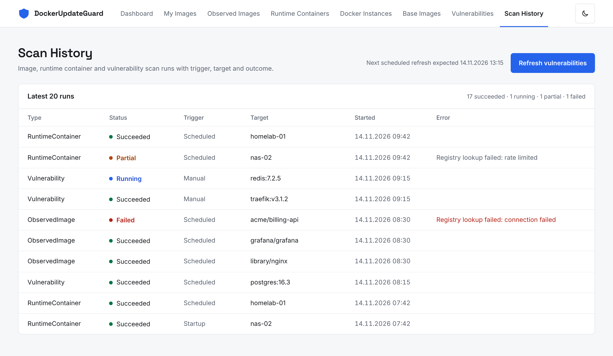

## What the mockups do not show

- **Narrow screens.** The mockups are drawn for the desktop. Below 1280 px the navigation collapses into a menu
  button that opens a drawer, and below 960 px table rows keep the card layout of the responsive redesign, in the
  flat style.
- **The detail pages** of My Images, Observed Images and Docker Instances, and the error and not-found pages. They
  follow the Runtime Container detail and the page header pattern.
- **Loading skeletons** and empty states of the list pages.
- **Advisory identifiers and digests** are placeholders (`CVE-[ID]`, `sha256:[DIGEST]`); all names, versions and
  figures are sample data, and the lists are shortened.

## Implementation issues

The work is split into nine dependency-ordered issues. Order: **1 → 2 → (3, 5, 6, 7, 8) → 4 → 9**.

1. Design tokens, typography and MudBlazor theme
2. Shared components: status indicators, severity chip and bar, page header, section panel, table styling
3. Dashboard that lists what needs attention
4. App shell: top navigation replaces the drawer
5. Runtime Containers list
6. Runtime Container detail
7. Vulnerabilities page
8. List pages: My Images, Observed Images, Base Images, Docker Instances, Scan History
9. Remaining detail pages, error pages and removal of the old styles

## Regenerating the images

```bash
cd docs/ui-concept/flat-refresh
node screenshot-mockups.cjs
```

The script needs the `playwright` package and its Chromium. The mockups load Inter from the application's
`wwwroot/fonts` folder and Space Grotesk from `mockups/fonts` (SIL Open Font License 1.1, see
`mockups/fonts/SpaceGrotesk-OFL.txt`).
